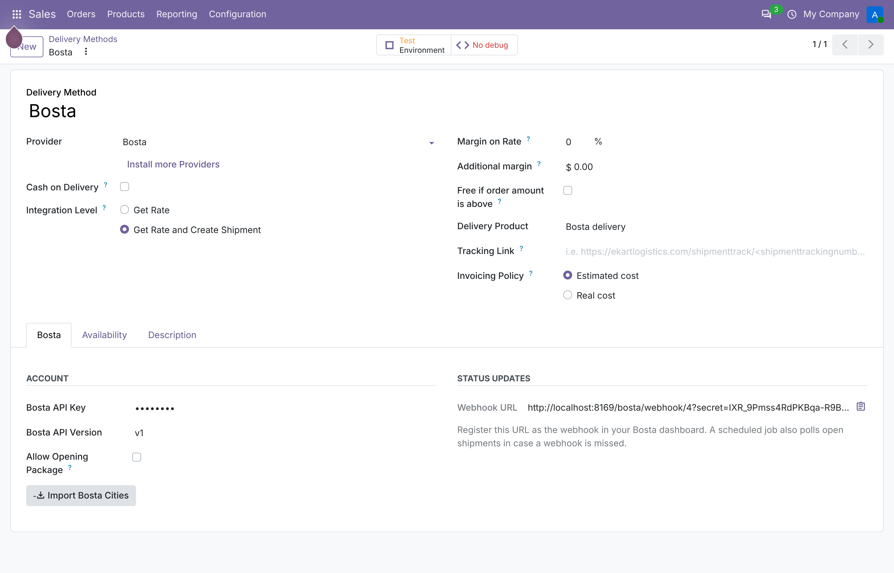

# Bosta Shipping for Odoo 20

Book [Bosta](https://bosta.co) deliveries straight from Odoo, with cash on delivery, and keep
each shipment's status in sync, for Egyptian e-commerce businesses running Odoo.



## What it does

- **Bosta as a delivery provider.** When a delivery order is validated, the shipment is created on
  Bosta and the tracking number is stored on the picking. No copying orders into the Bosta dashboard.
- **Cash on delivery, worked out for you.** The amount Bosta collects defaults to what is still
  unpaid on the sales order. Orders already paid online (for example on Shopify) send 0. It can be
  edited before booking and is locked once the shipment exists.
- **Egyptian addresses that Bosta accepts.** Each Odoo governorate is mapped to a Bosta city.
  "Import Bosta Cities" pulls the list from Bosta and matches governorates by name. Phone numbers are
  normalised (`+20 10 1234 5678` → `01012345678`), and landlines are rejected with a clear message,
  because couriers need a mobile.
- **Status updates two ways.** Bosta's webhook updates the shipment as it moves (Picked up, Delivering,
  Delivered, Returned...). A scheduled job also polls open shipments every 30 minutes in case a webhook
  is missed, and stops once a shipment reaches a final state. Every change is logged in the chatter.
- **Cancel from Odoo.** Cancelling the shipment terminates it on Bosta.
- **Problems surface before Bosta is called.** A missing city mapping, landline-only customer or
  missing street blocks booking with one message that lists everything to fix.

## Setup

1. Install `delivery_bosta` (depends on `stock_delivery` and `sale_stock`).
2. Inventory › Configuration › Delivery Methods › New: Provider **Bosta**, paste your Bosta API key.
   Leave **Test Environment** on to use Bosta's staging server until you're ready.
3. Click **Import Bosta Cities**, then check Inventory › Configuration › Bosta Cities and map any
   governorate that wasn't matched automatically.
4. Copy the **Webhook URL** from the Bosta tab into your Bosta dashboard's webhook settings.
5. Optionally set a **Tracking Link** with `<shipmenttrackingnumber>` so customers get a tracking URL.

## Tests

19 tests run on a real Odoo 20 and PostgreSQL, against a stand-in for Bosta's API:

- validating a delivery books Bosta with the right COD, city code, address, receiver and reference
- test mode uses Bosta's staging server, production mode the live one
- a COD override (prepaid order) sends 0
- missing city mapping / landline phone / Bosta error: clear message, nothing marked as shipped
- cancelling terminates the delivery on Bosta
- the polling job updates status and stops at Delivered
- webhooks: matched by tracking number or by order reference, wrong secret rejected (403),
  unknown shipments acknowledged without failing
- city import maps governorates by name and re-imports without duplicates

```bash
odoo-bin -d test --addons-path=<odoo>/addons,<this repo> -i delivery_bosta \
  --test-tags /delivery_bosta --stop-after-init
```

CI runs the same on every push.

## Status and limits

- Endpoints and field names follow Bosta's official SDKs (`bostaapp/bosta-nodejs` and `bostaSDK` on
  PyPI): `POST /api/v1/deliveries`, `GET /deliveries/<tracking>/tracking`, `DELETE /deliveries/<id>`,
  `GET /cities`, with the API key in the `Authorization` header. The API version is a setting.
- **Not yet run against a live Bosta account.** Tests use a stand-in that answers like Bosta's API.
  Before going live, book one shipment on Bosta's staging server and check the payload is accepted.
- Bosta prices come from your contract, so the shipping charge on the order is the delivery product's
  price, not a live rate.
- Bosta webhooks aren't signed, so the webhook URL carries a per-carrier secret, checked in constant time.

## License

LGPL-3
